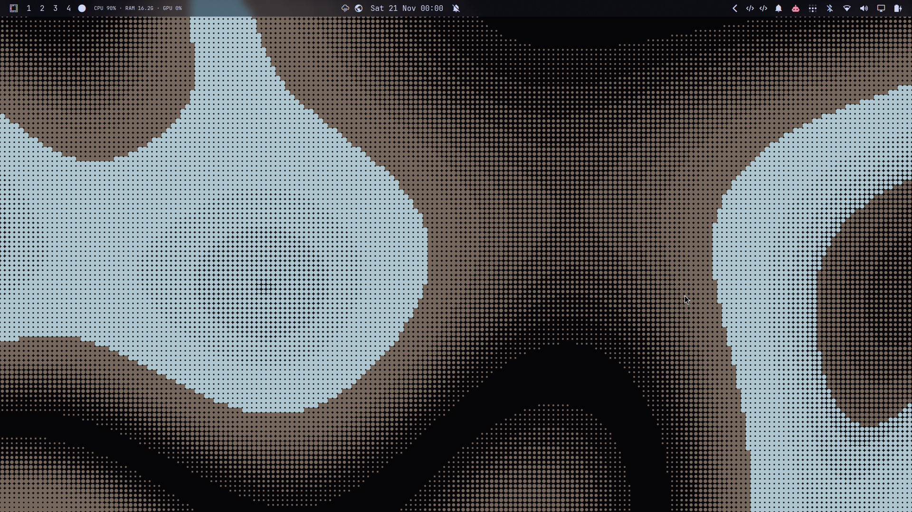

# dotfiles



Omarchy 4 on Arch Linux, Hyprland 0.56.2 in Lua mode, on a Dell G15 5525. The Radeon 680M drives
the laptop panel, the RTX 3050 owns the HDMI port. The wallpaper is not a video: it is
[ASCII Paper](https://cyoren.github.io/asciipaper/), an animated ASCII renderer running as its own
Wayland background layer.

## The wallpaper

ASCII Paper writes every frame on the GPU: one shader returns a colour and a brightness per
character cell, a glyph ramp turns that into text. It runs as a `systemd --user` unit pinned to the
background layer, so the compositor treats it as wallpaper and windows never fight it.

| Piece | Path |
|---|---|
| launcher | `~/.local/bin/asciipaper` 1.6.0, native renderer in `~/.local/bin/asciipaper-engine` |
| service | `.config/systemd/user/asciipaper.service`, `ASCIIPAPER_SERVICE=1`, `PartOf=graphical-session.target`, restarts on failure |
| tuning | `.config/asciipaper/engine.json`: 25 fps, 9 fps when idle, quality 1.5, pointer 1.8, speed 1.35, `"renderer": "native"` |
| selected look | `.config/asciipaper/wallpaper` → `plasma-mine-9` |
| the look itself | `.local/share/asciipaper/user-wallpapers/plasma-mine-9.json` and `.glsl` |

`Drift` is what the screenshot shows: `dots` shape, cell 10, charset ` .:-=+*#%@`, an eight colour
palette on `#050507`, swirl interaction (strength 0.4, radius 0.25) so the pointer drags the field,
pace 0.3. The shader is 14 lines of demoscene plasma, and both files are in this repository.

```sh
asciipaper preview plasma-mine-9      # try it in a normal window
asciipaper set plasma-mine-9          # choose it and restart the service
systemctl --user status asciipaper
```

It is cheap by design: one full screen quad per frame, 9 fps when idle, and it pauses behind windows
and while the machine is locked. On a 680M that matters more than it sounds.

ASCII Paper is free on Linux (tarball or PKGBUILD from the site above) and paid on the app stores.
If you came here for ricing, the reusable part is the engine:
[cYoren/asciipaper-engine](https://github.com/cYoren/asciipaper-engine) is public, MIT, and renders
the same JSON specs without the app.

## What is in here

| Path | What |
|---|---|
| `.config/hypr/` | Lua config: monitors, input and native gestures, bindings, look and feel, autostart, `autoscroll.lua`, `plugins-extra.lua`, `hyprsunset.conf` |
| `.config/omarchy/` | bar layout (`shell.json`: glassy, sysstats, weather and an `elsewhen` world clock), `bar/scripts/sysstats`, branding, hooks, and the two bar widgets I wrote |
| `.config/asciipaper/`, `.local/share/asciipaper/user-wallpapers/` | wallpaper tuning, choice and the Drift spec |
| `.config/systemd/user/asciipaper.service` | starts the wallpaper with the graphical session |
| `.config/{kitty,alacritty,ghostty,foot}/` | terminals |
| `.config/{nvim,tmux,btop,starship.toml,git/config}` | LazyVim, tmux, btop, prompt, git identity and credential helper |
| `.local/bin/dev`, `.local/bin/dev-sync` | project launcher (`fzf` over every repo, runs it by type) and a fast-forward-only sync of every checkout |
| `.bashrc`, `.bash_profile`, `.profile`, `.zshrc`, `.local/bin/env*` | shell startup; paths use `$HOME`, never a hard coded user |
| `etc/modprobe.d/nvidia.conf` | NVIDIA runtime power management (installed by hand, see below) |
| `manifests/` | native packages, foreign packages, wallpaper runtime dependencies |
| `scripts/` | `restore.sh`, `capture-manifests.sh` |
| `archive/` | the previous Debian, Plasma and Nix setup |

## Mine and not mine

Mine: everything in `hypr/`, the bar layout, `sysstats`, the two `gus.*` bar widgets, `dev` and
`dev-sync`, the Drift wallpaper, the print of this README.

Not mine, and not copied here: the four shell plugins I run are other people's work, installed with
`omarchy plugin add <url> --enable`:

```sh
omarchy plugin add https://github.com/piyush97/omaswitch.git --enable                     # Alt+Tab with previews
omarchy plugin add https://github.com/zzwong/omarchy-stage --enable                     # Mission Control overview
omarchy plugin add https://github.com/bobby-nicholas/omaland --enable                   # visual look editor
omarchy plugin add https://github.com/Shavanced/omarchy-notification-center-plugin.git --enable
```

The compositor plugins are built from source against Hyprland 0.56.2 and loaded by
`.config/hypr/autoscroll.lua` and `.config/hypr/plugins-extra.lua`. Rebuild them after every
Hyprland update, the commands are in the comments of those two files:

- [estebanhiram/hypr-autoscroll](https://github.com/estebanhiram/hypr-autoscroll): middle click autoscroll, `SUPER + A` toggles it off for terminals
- [savonovv/hypr-kinetic-scroll](https://github.com/savonovv/hypr-kinetic-scroll): inertial scrolling
- [horriblename/hyprgrass](https://github.com/horriblename/hyprgrass): loaded, but this laptop has no touchscreen so its gestures never fire; touchpad gestures are native Hyprland ones in `input.lua`

## Restore

Start from a working Omarchy install with network, a user account, and `yay`. On a bare Arch install
add the Omarchy and BlackArch repositories first, the package lists assume they exist.

```bash
git clone https://github.com/cYoren/dotfiles.git ~/Documents/dotfiles
cd ~/Documents/dotfiles
sudo pacman -S --needed - < manifests/pacman-explicit.txt
yay -S --needed - < manifests/aur.txt
sudo pacman -S --needed - < manifests/runtime-dependencies.txt
./scripts/restore.sh --dry-run
./scripts/restore.sh
```

`restore.sh` overlays only the paths in this repository, never deletes unrelated files, and keeps the
previous version of every replaced file under `~/.local/state/dotfiles-restore-backups/<stamp>/`.
It also enables `asciipaper.service`, which starts with the next graphical session. The wallpaper
needs `gtk4-layer-shell`, `python-gobject` and `webkit2gtk-4.1` (in `runtime-dependencies.txt`), and
the app itself: install it from [the site](https://cyoren.github.io/asciipaper/).

System level, by hand, because none of it can live in `$HOME`:

```bash
sudo install -Dm644 etc/modprobe.d/nvidia.conf /etc/modprobe.d/nvidia.conf
```

Kernel command line on this laptop: `acpi_backlight=native amdgpu.dcdebugmask=0x10`. `acpi_backlight`
gives the brightness keys back to `amdgpu_bl0` (a bogus `nvidia_wmi_ec_backlight` device was hiding
it), `dcdebugmask=0x10` disables PSR to stop recurring DMCUB errors. Check the bootloader before
copying either.

Known sharp edge, since it looks like an Omarchy bug: `hyprland.lua` exports
`__GLX_VENDOR_LIBRARY_NAME=mesa` so video decodes on the iGPU instead of crossing GPUs and going
black. Steam Linux Runtime games that bundle their own `libstdc++` crash with it (CS2 segfaults at
the main menu). Fix per game with the launch option `env -u __GLX_VENDOR_LIBRARY_NAME %command%`.

## Refresh the package lists

After installing or removing software on purpose:

```bash
./scripts/capture-manifests.sh
```

It records package names, not versions. Review the diff before committing, and never add tokens,
private keys, browser data or other credentials to this public repository.

## Archive

`archive/debian-plasma-hyprland-nix/` is the previous Debian setup: KDE Plasma, Hyprland through Nix
Home Manager, its own manifests and the older ASCII wallpapers. Its README describes that restore
flow. Nothing in it is active on this machine.
